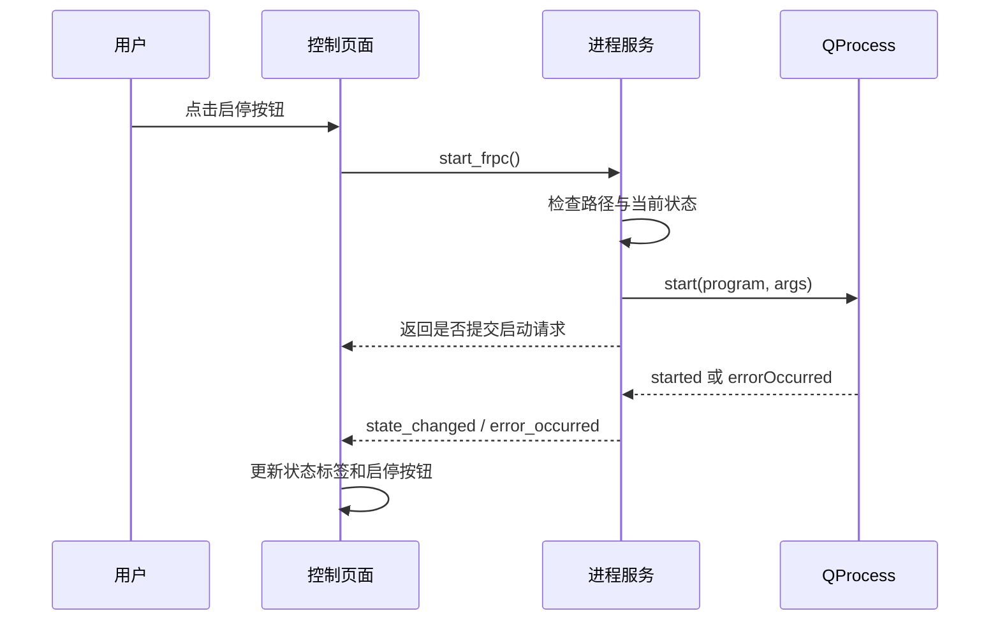

# 第 26 章　从教材走进 EasyFrp 源码

[上一章](25_练习提示与参考思路.md) · [总目录](00_阅读地图与学习方法.md) · [下一章](27_示例验证记录.md)

本章以当前工作区的 EasyFrp 源码为阅读材料。它不是让你立刻修改实际配置或启动 FRP 服务；先通过源码、断点规划和调用图理解职责。真实项目会演进，下面使用类名和方法名定位，避免把固定行号当成永久依据。

## 26.1 先看启动链，不要按文件夹顺序读完

从[项目入口](../../main.py)开始。入口用自身文件路径找到 `src`，将其加入模块搜索路径，然后导入 `frp_gui.app.run`。它还使用 `if __name__ == "__main__"`，避免被导入时自动启动窗口。

接着读[应用启动模块](../../src/frp_gui/app.py)。`create_application()` 创建 `QApplication` 并设置应用身份；`run()` 准备目录、创建应用、实例化主窗口、显示、进入事件循环。把它与第 03 章的最小程序对比，骨架是相同的，只是启动前增加了项目资源准备。

注意 `ensure_runtime_directories()` 会创建运行目录并补齐缺失的空 TOML 文件，不覆盖已有内容。理解启动链不必立刻运行整个项目；阅读时区分“纯对象组装”和“会修改文件系统的动作”。教材示例的运行不会调用这个函数。

## 26.2 主窗口负责把页面组合起来

[MainWindow](../../src/frp_gui/ui/main_window.py) 使用 `QTabWidget` 承载两个控制页，并将 `tabPosition` 设置为 `West`，使标签显示在左侧。沿 `__init__()` 中创建容器、添加页面的顺序阅读，再看 `closeEvent()` 的退出清理。

同一文件中的 `HorizontalTabBar` 通过 `tabSizeHint()` 调整标签尺寸，再用 `QStylePainter` 分别绘制原生侧边背景和横向文字。它只改变标签显示，点击、键盘导航和页面切换仍由 Qt 管理。

构造方法创建 frpc、frps 两个固定控制页。两种控制入口同时可见，无需读取模式设置，页面在整个主窗口生命周期内持续存在。

`addTab(页面, 标签文字)` 同时登记页面和入口，Qt 自动处理标签切换，无需单独维护导航列表与页面堆栈的信号连接。页面切换只改变可见内容，不启动或停止 FRP 进程。

项目当前主窗采用固定尺寸。这是当前实现的取舍，不是所有 Qt 项目必须固定窗口。复习第 06 和 14 章后，可以单独在练习项目里比较固定尺寸与响应布局对字体放大和长文本的影响。

## 26.3 沿一次“启动 frpc”追踪

相关文件：

| 文件 | 阅读重点 |
|---|---|
| [控制页面](../../src/frp_gui/ui/pages/frpc_control_view.py) | 页面如何使用可选中的 QPushButton 手动启停进程、禁用按钮并显示状态 |
| [进程服务](../../src/frp_gui/backend/frpc/process_service.py) | QProcess 如何启动、丢弃输出、报告失败与结束 |
| [主窗口](../../src/frp_gui/ui/main_window.py) | 如何切换两个控制页并在退出时清理进程 |

服务的 `start_frpc()` 返回真，表示已经提交启动请求，不表示 FRP 已经成功连接远程服务器。`QProcess.started` 说明系统创建了子进程，也不等于该进程的业务准备全部完成。如果未来要显示“远程连接成功”，需要解析进程提供的协议、状态接口或可靠日志，定义另外一层业务状态。

这是初学者经常混淆的三个时刻：按钮被点击、系统程序已启动、程序内部业务已就绪。把三者分清，界面才不会过早显示成功。

## 26.4 状态如何返回到控件

阅读 `FrpcProcessState` 可以看到 stopped、starting、running、stopping。服务负责维护状态，控制页面根据状态调整开关文字、选中和可用性。不要只在按钮点击时盲目反转文字，否则外部进程崩溃时界面会停留在错误状态。

控制页面中 `_syncing_switch` 用于区分“用户操作开关”与“代码同步开关显示”。后者也可能触发 `toggled`，如果无保护，就可能又发起启停命令。它是第 07 章反馈循环问题在真实项目中的例子。

控制页面直接监听进程服务信号，更新原生按钮和状态标签。错误也在对应页面的状态标签中显示，主窗口不创建状态栏或转发运行消息。

## 26.5 读配置与路径，而不是只看窗口

当前产品不再提供配置编辑和应用设置服务。进程服务仅检查可执行文件与 TOML 文件是否存在，再通过 `-c` 参数将配置路径交给 FRP。配置内容由用户在外部编辑器维护，FRP 负责解析和校验。教材中的 JSON 文件读写与严格校验仍可作为独立练习。

[路径模块](../../src/frp_gui/utils/paths.py)根据源码或打包运行方式确定应用根目录，并直接创建缺失的配置文件。当前实现把打包后的可写目录放在可执行文件旁，属于便携式分发的一种选择；如果装到受保护的目录，写权限就需要重新考虑。第 13、20 章介绍的 `QStandardPaths` 是另一种适合用户数据的选择，不能把某个项目路径策略当成所有程序的统一规则。

## 26.6 真实代码也值得提出问题

读代码不是背注释，而是用行为验证设计。以下是阅读练习，不是本次对业务源码的修改：

- 当前进程服务通过 `QProcess.nullDevice()` 丢弃标准输出和标准错误。如果仅删除界面日志框而继续让 QProcess 缓存未消费的输出，会对长时间运行有什么影响？
- 退出路径中的 `shutdown()` 使用有超时的 `waitForFinished()`。调用期间主线程能否继续处理普通界面事件？与第 15、16 章的延后关闭方案比较。
- 返回值只表示“请求已提交”时，界面文案该写“正在启动”还是“启动成功”？
- 重建导航、同步启停按钮，都可能产生信号；哪些信号应该被暂时屏蔽，哪些必须显式通知？

这些问题不是要求你为了理论上的完美立即重构。先明确使用场景、复现行为和改动价值，再决定是否修改。

## 26.7 一次有目标的源码阅读练习

选择“用户停止 frpc”这一条路径，独立写一页说明：从哪个信号开始，经过哪几个方法，谁改变状态，温和停止失败后怎样处理，最后哪个地方恢复按钮可用。然后把“子进程自己退出”和“启动文件不存在”也各走一遍。

需要调试时，先使用第 16 章自己的演示子进程练习断点和日志；掌握过程后，再在你明确准备好的真实运行环境中验证项目。不要为了学一个信号而同时引入服务器、权限、网络和配置等多种变量。

完成标准：你能在不通读全部文件的情况下，通过用户动作定位相关层，并判断一个改动应该放在控件、页面、服务还是数据模型。达到这里，你已经从“看到很多文件就无从下手”进入了有方法的项目阅读。
